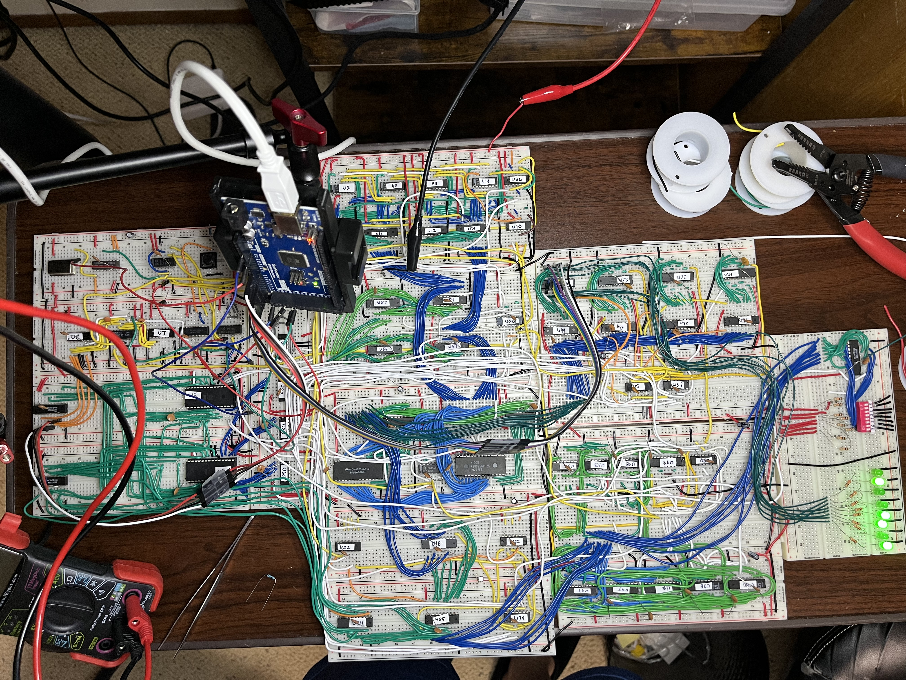
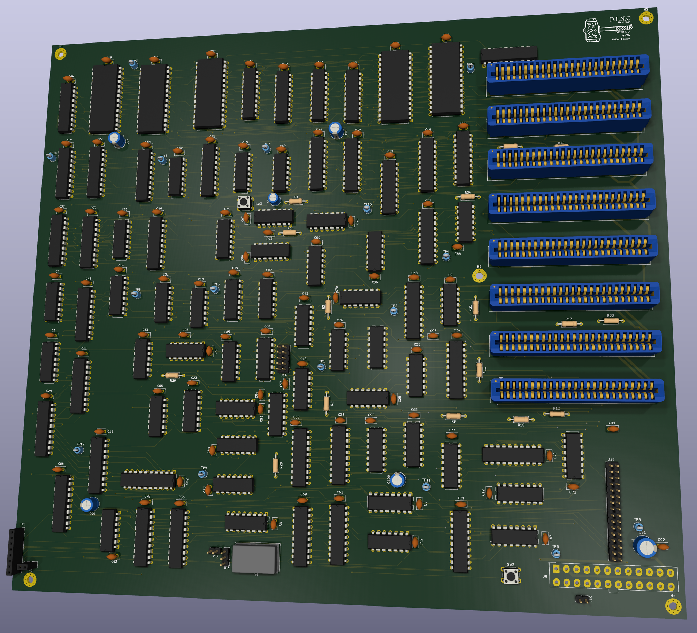

# DINO

**D**iscrete **I**ntegrated **N**ISC **O**perator — an 8-bit CPU built from
74-series logic. No microcontroller, no FPGA, no CPU chip: every register,
every bus, every gate is a chip you can put a probe on.

Schematics in KiCad, horizontal microcode in three EEPROMs, a ROM monitor
over a 16550 serial card, and SCELBAL BASIC running on it.

<table>
<tr>
<td width="50%"></td>
<td width="50%"></td>
</tr>
<tr>
<td><b>The prototype</b> (2026-09-10). Every module on breadboards, wired
by hand, running at 1.024 MHz.</td>
<td><b>Rev 1.0</b> (2026-10-29). The same netlist on one 4-layer board,
299 x 270 mm, eight card slots. Through fab review.</td>
</tr>
</table>

## Status, 2026-10-29

**The breadboard machine is complete.** It runs at 1.024 MHz off its own
crystal, executes from ROM and RAM, takes interrupts, and talks over serial.

- **174-instruction ISA.** `PROG_isa` passes 147 subtests; `PROG_isasoak`
  ran 50 consecutive passes (470,400 subtest executions) clean.
- **Stack, CALL/RET, execute-from-RAM.** All 32K of RAM (0x8000-0xFFFF)
  holds data and fetches instructions.
- **Memory-mapped I/O.** A 16K I/O window with eight 2K card slots: a DIP
  switch card and a PC16550D serial card at 9600 8N1.
- **ROM monitor.** `D`ump, `W`rite, `O`ut, `L`oad hex, `G`o (a CALL, so a
  RET comes back to the prompt).
- **Interrupts.** One vector, `0x9090` in RAM; the interrupt monitor takes
  serial input on the 16550's receive interrupt and breaks on Ctrl-C.
- **Add-with-carry.** `ADC`/`SBB`/`ACI`/`SBI` through one '157 on the ALU's
  carry-in.
- **SCELBAL BASIC** (the 1974 8008 BASIC), machine-translated into DINO
  assembly, runs out of ROM: `PRINT 2/3` gives ` 0.6666667`.

**Rev 1.0, the PCB.** Five boards through PCBWay's audit; the order goes in once shipping is settled.
4 layers (GND and +5V planes inside), KiCad DRC 0 unconnected / 0 errors,
schematic parity 0. Routed by Freerouting 2.5.0. Added for bring-up: a clock
select header (1.024 MHz, 512k, 256k, 128k, or a debounced single-step
button), a 16-signal logic analyzer header, 15 scope ground loops, and
unpopulated cap pads on the clock nets. Power is an ATX supply into the
24-pin header.

**Next:** bring Rev 1.0 up, move the serial card onto an edge card, then
CompactFlash and a floppy card. DINO will not get DMA; that goes to the
next machine.

---

## The machine

**8-bit data, 16-bit address.** Horizontal microcode, no pipeline. A
**24-bit control word** per T-state comes out of three AT28C64B EEPROMs
(`U9`, `U15`, `U23`) addressed by `{opcode, T-state}`. T0 is the fetch row
for every opcode; a '163 T-counter steps the rows until `END`.

The source, destination and misc fields are each a 3-bit '138 decode, with
bank-select bits for a second bank, so **two bus sources can never be on at
once**: mutual exclusion is the decoder, not the microcode's good behaviour.

**Memory map:**

```
0x0000-0x3FFF   ROM (U24, 28C256, 16K decoded)
0x4000-0x7FFF   I/O window, eight 2K card slots
                  0x4000 card 0  DIP switches
                  0x4800 card 1  PC16550D serial, 9600 8N1
0x8000-0xFFFF   RAM, 32K
```

**ALU:** two 74F382s, ripple carry. All four flags latch in a '273 and only
update when the ALU is the source.

**Commit discipline:** everything that changes state is clock-qualified and
commits while the clock is low — register loads through `NOR(~LOAD, CLK)`,
the RAM write through `NAND(WRITE_DIR, WR_GATE)`, PC load, clear and count
each gated on their own. Bus output enables are ungated, so a decode runt
lands while CLK is high and reaches nothing. The one exception was the fetch
row, where the instruction register is transparent during CLK low; the RAM
write is gated off in T-state 0 to close it. The machine is fully static, so
the clock can stop.

**HALT is `0xFF`**, so an erased EEPROM halts instead of running wild.

**Adding an instruction costs a three-ROM burn.** Image CRCs are pinned as
literals in `test_microcode_gen.py`, so a reburn is always deliberate.

---

## The part worth reading about

Building a CPU from discrete logic is a known exercise. The interesting
problem is different: **on a breadboard, with 80+ chips and a thousand
jumpers, how do you know the machine you built is the machine you drew?**

```
schematic  ──▶  netlist audit  ──▶  generated artifacts  ──▶  bench
 (KiCad)        (gate equations      (microcode, ROMs,        (coverage ROMs:
                 extracted, not       slot maps, landing       each one names
                 eyeballed)           lists, answer keys)      its expected byte)
```

The rule underneath it: **nothing is retyped.** Every table in this repo —
the microcode, the program ROMs, the breadboard slot maps, the wiring
landing lists, the card-edge pinout — is generated by a script with its own
host tests, most of them from the KiCad netlist. A hand-maintained table
drifts the moment someone moves a wire, and drift is invisible until it
costs you an evening.

Every test assertion is **netlist-verified before it is written**. Reading
a schematic and typing what you think a gate does is how you write a test
that agrees with your misunderstanding.

The answer key is `simulate()` in `progrom_gen.py`: it interprets the real
microcode rows and computes what the output LEDs should read for each
coverage image. Each image ends in `HALT` with one byte on the LEDs, and the
byte either matches or it names what broke.

### Rules that were paid for on the bench

Each of these exists because something went wrong first:

- **Rails first.** A random, probe-sensitive fault that doesn't care which
  program runs is not in the datapath. Measure ground and VCC on every board
  before building a logic model. One halt hunt (2026-09-01) was 460 mV of
  ground offset.
- **Mirror-witness.** A write-then-read through the same bus bank is
  permutation-blind — a flipped jumper bank cancels itself out. Every
  module needs at least one asymmetric path.
- **A witness that rewrites the same value sees nothing.** Every plant must
  differ from what the cell already held.
- **Rate is not data.** Halt rates moved from 7/8 to 1/22 with probes, a cap
  and warmth. Use a witness that cannot miss: a pulse trigger, a planted
  byte, a soak with a count.
- **A change that is logically identical and only faster is a timing
  change**, and the simulator is blind to it.
- **No blind counters.** A failing assertion must name the lying signal, or
  the test is just a rumour.

### Faults this method caught

| Fault | How it was found |
|---|---|
| `U18.1` (OE) on `MDR_OUT` instead of `~MDR_OUT` | enable polarity inverted; cascaded into four failing tests until bus-fight analysis fingered it |
| PORTF→MDR jumper bank reversed | invisible to every A/B/C round trip, caught only by the asymmetric OUT-register path |
| `MDR5`↔`MDR6` crossed | decoded from byte 0 arithmetic alone: `0xA5 → 0xC5` is exactly a bit-5/6 exchange |
| Bridge DIR/EN keyed on destination instead of source | schematic bug — ADD could never have committed. Found by netlist audit before the board existed |
| `A8`-`A11` address rotation on the microcode ROM | the address-order test named every rotated line |
| A RET fetched from RAM latching `0xFF` | a 14 ns `~WE` runt during the fetch row; caught on a pulse trigger, fixed by gating the write off in T-state 0 |
| The ALU latching half its next answer | its latch enable on raw CLK at the end of a stub sat at 1.0-1.2 V for 20 ns; now driven by a gate |

---

## Layout

```
dino_v0_0_2/     KiCad project: the mainboard schematics and the Rev 1.0 PCB
dino_bus/        card-edge connector symbol and socket footprint
dino_io/         card 0, the DIP switch card
dino_serial/     card 1, the 16550 serial card
asm/             program sources (.asm); asm/ram/ loads over serial
roms/            the burned images, CRCs and expected outputs (roms/README.md)
docs/notes/      generators, design notes, host tests
docs/captures/   scope, logic analyzer and PCB review captures
datasheets/      74-series and memory parts
```

| Script (`docs/notes/`) | Emits |
|---|---|
| `kicad_netlist.py` | `build_report()` — the netlist oracle everything else asks |
| `kicad_contracts.py` | per-sheet contracts, `--continuity` landing lists, `--since` change lists |
| `microcode_gen.py` | the three microcode images, CRCs, header |
| `progrom_gen.py` | program ROMs and the `simulate()` answer key |
| `isatest_gen.py` | the ISA self-test family (`isa`, `isasoak`, ...) |
| `roms_readme_gen.py` | `roms/README.md` — the inventory read at the burner |
| `layout_gen.py` | breadboard placement, slot maps, wiring guides |
| `bus_gen.py` | the card-edge pinout, symbol and footprint |
| `netsim_gen.py` | the twin: the Rev 1.0 netlist as gate-level Verilog (`netsim/`) |
| `netsim_suite.py` | every runnable image on the twin against the oracle (`make twin`) |

```bash
make test               # host tests
make expected           # every coverage image's expected output
make assemble-<name>    # asm/<name>.asm -> roms/PROG_<name>.bin
make load-<name>        # asm/ram/<name>.asm over serial into RAM
make monitor            # minicom on the serial card
```

Burning is done by hand on a TL866; the tools verify, they never program.

---

## Retired

**The ATmega2560 bring-up rig** brought the machine up one module at a
time, then one integration block at a time, shedding wires as each block
was proven. Retired 2026-08-24. `tests/dino_bringup/` stays for its ROM
burn targets.

**The FPGA twin** generated VHDL from an earlier netlist. It was perfect
logic, so it could not see the faults that mattered, which were build,
analog and glitch faults. Retired 2026-08-24 and deleted 2026-10-30. The
only twin now is `netsim/`: the Rev 1.0 netlist exactly as drawn, chip by
chip and pin by pin, simulated in Icarus with typical delays. `make twin`
runs every image that needs no card (43 of them, `isa` and `isasoak`
included) and all match the oracle. The breadboard had a fetch glitch that the T0 write
gate fixed; unmeasured on the PCB; the twin is logically identical, gate
included.

---

*Schematic PDF: [`dino_v0_0_2/dino_v0_0_2.pdf`](dino_v0_0_2/dino_v0_0_2.pdf)*
